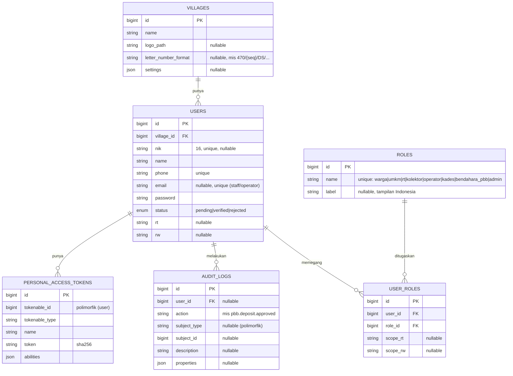

# ERD — Skema Database (Fase 0)

Level tinggi, sesuai `PEMBANGUNAN.md` §7. **Hanya tabel fondasi yang benar-benar
dibuat di Fase 0.** Tabel fitur (surat/PBB/UMKM/pengaduan) diberi tanda _planned_
dan baru di-migrate pada fasenya masing-masing (aturan satu fase per sesi).

Prinsip: **setiap tabel data menempel `village_id`** (multi-desa) dan **aksi penting
tercatat di `audit_logs`** (immutabel).

## Tabel Fase 0 (sudah ada)

## Tabel _planned_ (belum dibangun — rujukan fase berikutnya)

Dokumen ini hanya memetakan rencana; **jangan** dibuat migrasinya sekarang.
Referensi kode lama ada di `backend/reference-future-phases/`.

| Modul | Tabel utama | Fase |
|---|---|---|
| Surat | `letter_types`, `letters`, `letter_status_logs`, `letter_attachments` | Fase 2 |
| Pengaduan | `complaints`, `complaint_replies` | Fase 3 |
| PBB | `pbb_bills`, `pbb_claims`, `pbb_deposits`, `pbb_batches` | Fase 4 |
| UMKM | `umkm_shops`, `umkm_products`, `umkm_reports` | Fase 5 |

> Catatan: tabel `sessions`, `cache`, `jobs` bawaan Laravel juga aktif namun tidak
> digambar di ERD bisnis ini.
